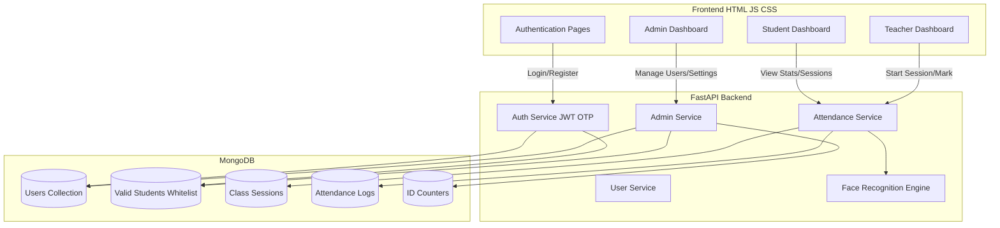
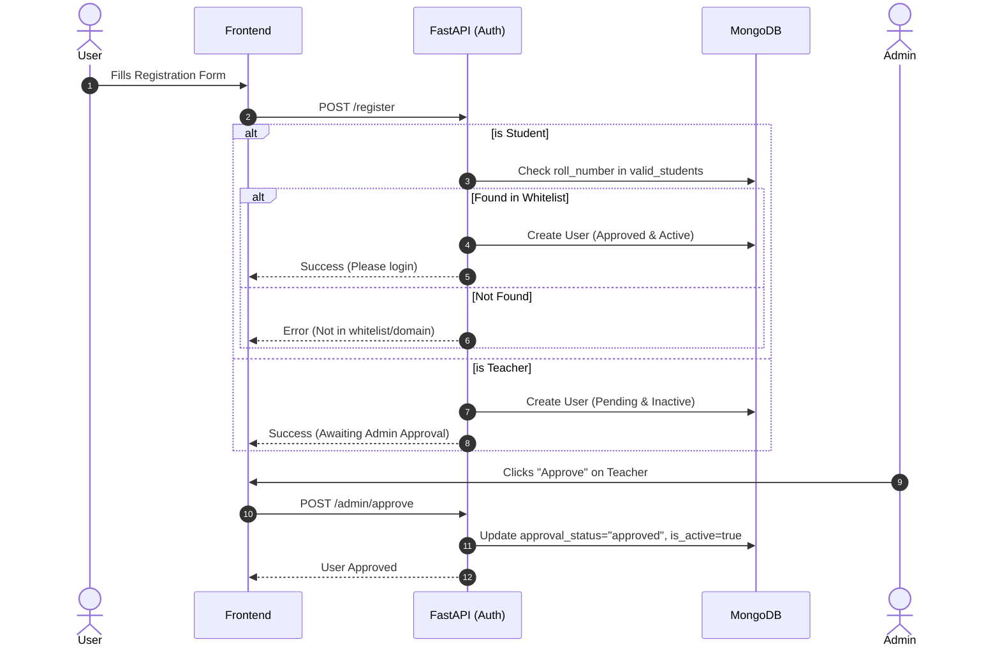
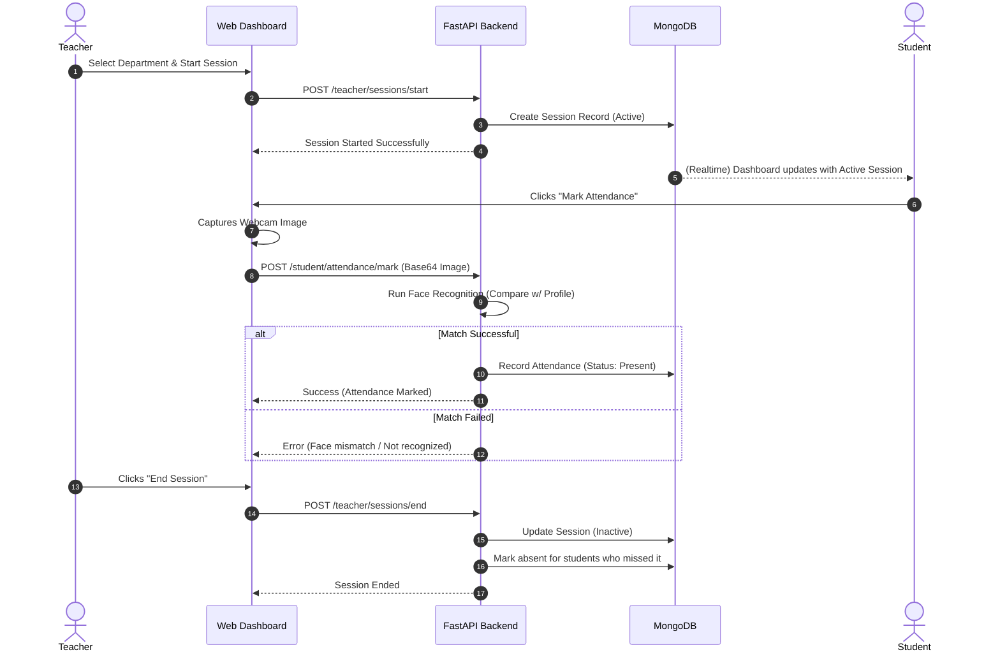
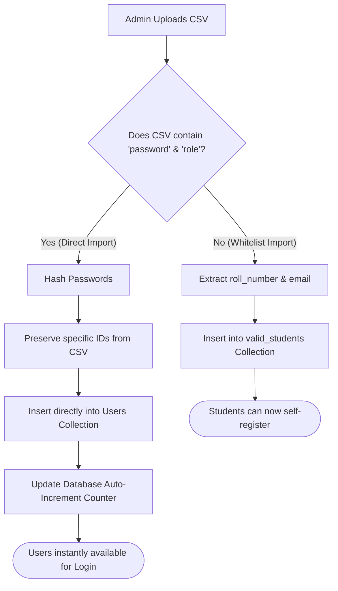

# Smart Attendance System - Workflows & Visualizations

You can use the following [Mermaid](https://mermaid.js.org/) diagrams to visualize the architecture, data flow, and core workflows of the Smart Attendance System. Most modern markdown viewers (like GitHub, VS Code, and Obsidian) natively support rendering these diagrams.

---

## 1. High-Level Architecture

This diagram visualizes the overall system components: the FastAPI backend, the MongoDB database, and the frontend interfaces.

---

## 2. Authentication & Account Approval Workflow

Visualizes how different roles (Students, Faculty, Admins) are registered, verified, and approved.

---

## 3. Class Session & Face Recognition Attendance Workflow

Visualizes the core feature: how a teacher starts a session and how students mark their attendance using facial recognition.

---

## 4. Admin CSV Import Workflow

Visualizes how admins can bulk-upload users via CSV.

